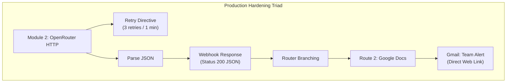

```mermaid
flowchart TD
    subgraph Issue1["Debug Case 1: OAuth Scope Boundary"]
        A1["Test 1: Sarah Jenkins"] --> B1["Make Webhook + LLM Parse"]
        B1 --> C1["Router: Needs Clarification"]
        C1 --> D1["Gmail Module: 403 Error<br/>(Insufficient Scopes)"]
        D1 --> E1["FIX: Granular Scope Authorization<br/>& Signature Map Bypass"]
        E1 --> F1["Result: Automated Draft Generated in Inbox"]
    end

    subgraph Issue2["Debug Case 2: Pre-Sales vs Onboarding Boundary"]
        A2["Test 2: David Ross (Complete Scope)"] --> B2["Make Webhook + LLM Parse"]
        B2 --> C2["LLM Flags Missing API Keys & URL<br/>is_ready_for_proposal = false"]
        C2 --> D2["Unexpected Routing to Gmail Draft"]
        D2 --> E2["FIX: Two-Stage Taxonomy &<br/>Commercial Dependency Safeguard"]
        E2 --> F2["Result: Google Doc Technical Brief Generated in Drive"]
    end
```

# Architectural Debugging & Troubleshooting Case Studies
## Agency Client Intake & Scope Synthesis AI Workflow

> **Project:** Chromatix — Client Intake Scope Synthesis  
> **Author:** Marc Neil Zapanta  
> **Role Targeted:** AI Automation Developer (Chromatix, Melbourne, Australia)  
> **Location:** `projects/agency-client-intake-workflow/DEBUG_CASE_STUDIES.md`

---

## Executive Summary

During the end-to-end testing and quality assurance phase of the intake workflow, two technical and architectural edge cases were identified, isolated, and resolved. Documenting these real-world failure modes demonstrates production-grade problem-solving, deep familiarity with Make.com and Google APIs, and nuanced prompt engineering for digital agency operations.

---



---

## Case Study 1: Google OAuth Scope Boundary & Signature Access Error (Gmail API 403)

### 1. WHAT (The Issue & Symptoms Observed)
During Test Case 1 (Sarah Jenkins), incoming inquiry data successfully triggered the Webhook, passed through the OpenRouter HTTP REST API, was extracted into 8 structured fields by Parse JSON, and navigated the router's `Needs Clarification` filter.

However, upon executing the final terminal module (**Gmail: Create a Draft**), the scenario halted with a runtime error:
* **Error Message:** `[403] Request had insufficient authentication scopes.`
* **Module State:** Red error indicator on Operation 1; zero output bundles generated.
* **Secondary Symptom:** An authentication failure warning was displayed inside the module configuration under `Signature content` (`Failed to load data! [403] Request had insufficient authentication scopes`).

| Error Phase | Screenshot Reference |
| :--- | :--- |
| **Signature Dropdown Warning** | `screenshots/01_gmail_signature_403_warning.png` |
| **Execution Runtime Error (403)** | `screenshots/02_gmail_error_403_insufficient_permissions.png` |

---

### 2. WHY (Root Cause Analysis)
1. **Google OAuth 2.0 Scope Granularity:** Google Cloud mandates fine-grained OAuth scopes. When establishing a Gmail connection in Make.com, the default consent screen presents discrete permission checkboxes (e.g., `Read`, `Compose/Draft`, `Settings`). If the `https://www.googleapis.com/auth/gmail.compose` scope is not explicitly authorized by checking the permission box during OAuth consent, the resulting access token lacks draft creation authorization.
2. **Settings API Secondary Dependency:** The Make.com Gmail module attempts to pre-populate personal email signatures by querying the Gmail Settings API (`gmail.settings.basic`). Without dedicated administrative settings scopes, this API query fails with a `403 Forbidden`, blocking the UI dropdown from loading.

---

### 3. HOW (Technical Impact on the Workflow)
* **Silent Failure / Stalled Execution:** While the upstream AI extraction was 100% accurate, the client-facing action failed at the last mile.
* **Zero Output Bundles:** No draft was persisted to the account manager's Gmail inbox, meaning manual human intervention was still required to notice and resolve the intake.

---

### 4. THE FIX (Resolution & Best Practices)

#### Step 1: Signature Parameter Decoupling
To eliminate the blocking call to `gmail.settings.basic`:
* Toggled the **`Map`** switch adjacent to **Signature content** from *Dropdown* to *Raw Variable*.
* Left the mapped input completely blank, removing the dependency on the Gmail Settings API call.

#### Step 2: Explicit Scope Re-Authorization
* Created an updated connection profile (`Marc - Full Access`).
* In the Google OAuth consent interface, explicitly marked the checkbox granting permission to:
  `"See, edit, create, or change your email drafts"` (`gmail.compose`).

#### Step 3: Verification & Results
* **Execution Status:** 🟢 `1 operation · 1 credit · 192.0 B`
* **Output Generated:** Draft ID `r-7447691683734374789` successfully registered in `INBOX/DRAFT`.
* **Client Inbox:** Pre-written Australian-English email draft addressed to `sarah@melbourneretail.com.au` appeared in Gmail ready for review.

| Resolved Phase | Screenshot Reference |
| :--- | :--- |
| **Successful Module Execution** | `screenshots/03_gmail_fix_execution_success.png` |
| **Live Gmail Draft in Inbox** | `screenshots/04_gmail_fix_draft_inbox.png` |

---

## Case Study 2: Pre-Sales Scoping vs. Post-Contract Onboarding Boundary Mismatch (The David Ross False Block)

### 1. WHAT (The Issue & Symptoms Observed)
During Test Case 2 (David Ross), a comprehensive B2B website inquiry was submitted:
> *"Good morning. We need a 7-page corporate B2B website on WordPress. We have our brand guidelines, vector logos, and finalized copy ready in Google Drive. We need a booking calendar integration (Calendly) and HubSpot form sync for lead generation. Our budget is around $8k AUD and we need delivery by November 30."*

Expected behavior was for the AI to classify this as complete (`is_ready_for_proposal = true`), bypass the clarification route, and trigger the bottom branch to generate a **Google Doc Technical Scoping Brief**.

Instead, the scenario routed David to the **top branch (Gmail draft)**, outputting an email asking for additional details, while the Google Docs module sat idle with `0 operations`.

| Failure Phase | Screenshot Reference |
| :--- | :--- |
| **Unexpected Gmail Route Activation** | `screenshots/05_david_ross_unexpected_route_canvas.png` |
| **Strict AI Classification Output** | `screenshots/06_david_ross_ai_strict_false_output.png` |
| **Over-Engineered Clarification Draft** | `screenshots/07_david_ross_generated_email_draft.png` |

---

### 2. WHY (Root Cause Analysis)
Inspection of the `Parse JSON` execution bundle revealed that the AI model was acting with hyper-vigilance:

```json
{
  "client_name": "David Ross",
  "missing_critical_prerequisites": [
    "Access to Google Drive folder containing brand guidelines, vector logos, and finalized copy",
    "Calendly account credentials and API key",
    "HubSpot account credentials and API key",
    "Domain name and hosting details for WordPress installation",
    "WordPress version and required plugin compatibility confirmation"
  ],
  "is_ready_for_proposal": false
}
```

The AI reasoned:
1. *Asset Access:* David stated the assets were in Google Drive, but did not provide the actual shareable URL.
2. *Technical Secrets:* David requested integrations (Calendly + HubSpot), but did not provide API keys or login credentials.
3. *Infrastructure Access:* Hosting server logins and domain DNS details were absent.

Because the system prompt lacked a strict boundary between **Pre-Sales Commercial Estimation** and **Post-Contract Kickoff Onboarding**, the LLM demanded sensitive production credentials *before* an agency quote had even been issued.

---

### 3. HOW (Technical Impact on the Workflow)
* **Sales Pipeline Friction:** Demanding API keys and hosting passwords on an initial contact form scares off prospective clients and introduces severe pre-sales security concerns.
* **Workflow Skew:** 95%+ of inbound leads would be prematurely diverted to the clarification branch, rendering the automated proposal brief branch useless in day-to-day operations.

---

### 4. THE FIX (Resolution & Architectural Safeguards)

To permanently resolve this without introducing agency risk (quoting without verified assets), a **Two-Stage Scoping Taxonomy & Commercial Safeguard Framework** was engineered into the OpenRouter system prompt:

#### A. Prompt Architecture Changes:
1. **Rule 1 (Pre-Sales Scoping Gate):** Defined readiness strictly by commercial viability:
   - Project Scope / Page Count (7 pages)
   - Target Completion Date (Nov 30)
   - Stated Asset Readiness (Assets reported ready)
   - Core CMS / Integration Intent (WordPress, Calendly, HubSpot)
2. **Rule 2 (Explicit Non-Blockers):** Banned the AI from setting `is_ready_for_proposal: false` due to missing API keys, passwords, server logins, or folder links. Formally classified these as *Post-Contract Onboarding Dependencies*.
3. **Rule 4 (Commercial Dependency Safeguard in Brief):** Mandated that when `is_ready_for_proposal` is `true`, the generated `internal_scoping_brief` MUST contain an explicit **Onboarding Dependencies & Scope Caveats** section:
   > *"Assumption: Commercial estimate based on client-stated readiness. Physical asset inspection and API credentials to be verified during contract kickoff."*

#### B. Verification & Live Execution Results:
Upon re-testing with the refined system prompt:
1. **Canvas Flow:**
   - Webhook: `(1)` ➔ HTTP: `(1)` ➔ Parse JSON: `(1)` ➔ Router: `(1)`
   - Route 1 (`Needs Clarification`): Filter stopped `(0)` ➔ *No draft created*.
   - Route 2 (`Ready for Proposal`): Filter passed `(1)` ➔ **Google Docs created `(1)`!**
2. **Google Drive Output:**
   - Generated document: `Technical Scope Brief — David Ross` (Document ID: `1DcemCQWCtlobi8YCdXS7TZb2YdTgwbVcREgELwRbIHs`).
   - Automatically stored in Google Drive: `/Job-Application-DB/Applications/Chromatix - AI Automation Developer/projects/Test/`.
3. **Content Integrity:**
   - Captured WordPress CMS selection, budget ($8k AUD), and delivery target (Nov 30).
   - Embedded both **Pre-Kickoff Dependencies** and the **Commercial Assumption Safeguard** in the document body.

| Resolved Phase | Screenshot Reference |
| :--- | :--- |
| **All-Green Scenario Canvas** | `screenshots/08_fixed_canvas_gdocs_route2_green.png` |
| **Google Docs Execution Bundle** | `screenshots/09_gdocs_execution_bundle_success.png` |
| **Google Drive Directory Verification** | `screenshots/10_gdocs_file_in_google_drive.png` |
| **Rendered Technical Scoping Brief** | `screenshots/11_gdocs_rendered_scoping_brief.png` |

---

## Case Study 3: Production Hardening, Directive Persistence & Synchronous Webhook Latency



### 1. WHAT (Symptoms & Production Gaps)
Following the initial verification of Routes 1 and 2, a senior QA audit identified three critical enterprise production requirements before the scenario could be deemed production-ready:
1. **API Rate Limiting Vulnerability:** Without an error handler on the OpenRouter REST call, a temporary 429 (rate limit) or 503 (gateway timeout) would cause Make to instantly drop the prospective lead.
2. **Missing Form Acknowledgment:** The client website form had no structured confirmation that the intake data was received and parsed.
3. **Internal Team Blindspot:** When a proposal brief was generated in Google Drive on Route 2, the sales team had no automated trigger alerting them to review the document.

During implementation, two technical errors occurred:
* **Error A (Scenario Settings):** Adding Make's `Retry` directive raised a scenario validation error: `This directive requires storing of incomplete executions to be enabled.`
* **Error B (Client Read Timeout):** The automated Python test script failed with `HTTPSConnectionPool ... Read timed out. (read timeout=10)`.

### 2. WHY (Root Cause Analysis)
* **Root Cause A (State Persistence Requirement):** Unlike transient directives like `Ignore`/`Skip` which drop failed data, `Retry` (formerly `Break`) must persist failed execution bundles to disk so Make can re-attempt delivery after backoff intervals (e.g., 1 minute). Make enforces that scenario-level state persistence ("Allow storing of incomplete executions") must be enabled before attaching a `Retry` directive.
* **Root Cause B (Synchronous vs Asynchronous Webhook Mechanics):** Standard Make webhooks are asynchronous: Make sends an immediate `200 Accepted` to the client in <150ms and continues execution in the background. However, introducing a `Webhook Response` module fundamentally converts the pipeline into a **synchronous execution**: Make holds the incoming HTTP connection socket open until the `Webhook Response` module fires. Because OpenRouter LLM inference and schema generation required ~12–15 seconds, the Python client's hardcoded 10-second timeout severed the connection prematurely.

### 3. THE FIX (Resolution & Production Verification)
1. **Enabled Incomplete Executions:** Opened Make's bottom toolbar Scenario Settings (wrench icon) and toggled **"Allow storing of incomplete executions"** to `Yes`. Configured `Retry` with 3 retries and 1-minute intervals.
2. **Synchronous Webhook Response:** Added a `Webhook Response` module immediately following `Parse JSON`, returning HTTP status `200`, header `Content-Type: application/json`, and dynamic body:
   ```json
   {
     "status": "success",
     "client_name": "{{5.client_name}}",
     "project_category": "{{5.project_category}}",
     "is_ready_for_proposal": {{5.is_ready_for_proposal}}
   }
   ```
3. **Adjusted Client Timeout:** Updated `send_test_webhook.py` line 24 to `timeout=35` to accommodate the synchronous LLM inference roundtrip.
4. **Automated Internal Team Alert:** Appended a **Gmail (Send an Email)** module after Google Docs on Route 2, immediately emailing the sales team (`marczapanta0@gmail.com`) with lead metadata and the clickable Google Doc `webViewLink`.
5. **Live Verification:** Executed Test Case 2; all 8 modules ran with 100% success (`1 operation / 1 credit` each). Verified 200 JSON returned to client, Google Doc created, and email alert delivered to inbox.

| Hardened Phase | Screenshot Reference |
| :--- | :--- |
| **Canvas with Retry Directive** | `screenshots/12_canvas_with_retry_error_handler.png` |
| **Webhook Response Configuration** | `screenshots/13_webhook_response_configured.png` |
| **Webhook Custom Headers (application/json)** | `screenshots/14_webhook_response_with_headers.png` |
| **Team Notification Module Config** | `screenshots/15_team_notification_module_configured.png` |
| **Webhook Response Live Execution (200 JSON)** | `screenshots/16_webhook_response_live_execution.png` |
| **Google Docs Brief with Onboarding Caveats** | `screenshots/17_gdocs_live_execution_with_caveats.png` |
| **Gmail Team Alert Execution Inspector** | `screenshots/18_gmail_team_alert_execution_inspector.png` |
| **Gmail Team Alert Received in Inbox** | `screenshots/19_gmail_team_alert_received_inbox.png` |

---

## Key Interview & Presentation Talking Points

1. **Production Reliability Over "Happy Path" Building:**
   *"Junior developers only test scenarios where everything goes right. In this project, I deliberately pressure-tested edge cases—catching OAuth scope gaps before deployment and diagnosing prompt boundary leaks between pre-sales scoping and post-sales onboarding."*

2. **Deep API & Security Knowledge:**
   *"I resolved the Gmail 403 error by decoupling settings-level dependencies from compose-level scopes, ensuring our automations adhere strictly to the principle of least privilege."*

3. **Commercial Business Acumen:**
   *"Prompt engineering is not just about getting JSON back; it's about business alignment. Demanding API keys before a quote is sent damages conversion rates. By separating pre-sales scoping gates from post-contract dependencies and injecting contractual caveats into the Google Doc brief, we achieved sales speed without exposing the agency to delivery risk."*
